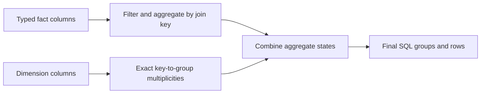

# A different execution model for RAMSQL

Status: researched design plus an allocator-free algebra proof. The SQL server
does not execute this design yet. No database speedup, new SQL capability or
100M-row qualification is claimed by this document.

## Recommendation

Build typed, factorized query pipelines over a compact columnar base with an
MVCC delta store. First apply the algebra to existing committed scan columns;
then replace the expensive base representation. These are separate measurable
steps, not a requirement to rewrite the entire database before testing the idea.

The important change is to keep a relation as keys, multiplicities and aggregate
states for as long as possible. Construct SQL Cells and output rows only where
an operator genuinely needs them. A GROUP BY feeding another GROUP BY should
pass aggregate states, not format and materialize a temporary SQL table.

This is an architectural application of established factorization principles,
not a claim to have discovered a new mathematical theorem.

## What the implementation audit found

The inspected SQL baseline is ZPM `9606877fcd05157af52e2965c5240388d68cc4a9`.
The inspected RAMSQL runtime is `0cf7784e4965cd8daba7f7ae7b15553d72ab5c36`.
Later benchmark evidence commits do not alter that runtime.

| Layer | Current behavior | Consequence / required change |
| --- | --- | --- |
| Storage, `storage.sig: Version` | A full `[columns]Cell` in every MVCC version | Storage cost follows maximum representable cell width, not actual values. Separate typed base columns and version deltas. |
| Storage, committed projections | Additional full-width i64 columns, live/null flags | Good first substrate for typed kernels, but duplicates data and does not solve base-store capacity. |
| Binder, `joinProbe` | Recognizes equality against a later source's primary key | Useful uniqueness evidence for aggregate pushdown; retain explicit proofs, not guessed foreign-key validity. |
| Executor, `nextStreamTuple` | Filters early but gathers Cells, probes dimensions and evaluates row expressions for surviving facts | Partial aggregation before joins can remove most of those visits. |
| Executor, `materializeCte` / `persist` | Ordinary CTE output is retained as Cell rows | Single-consumer aggregate pipelines should pass typed state directly. Recursive/multiple-use/volatile cases need a separate decision. |
| Executor, `typedDenseGroup` | Efficient COUNT/SUM scan but converts every group back to the general representation | Keep the typed representation through the consumer and final aggregate. |
| Storage, `Rollup` | Useful maintained summaries, but a compiled group budget and full Cell keys/per-column state | A bounded synopsis is not a scalable typed aggregate index. Budget indexes independently and measure update costs. |
| SQL `ReadContext`, RAMSQL `dispatchRead` | Statement-owned preparation and borrowed source lifetime; detached preparation is cleared after codec calls | Prepared typed plans need owned source, parameter/session/schema invalidation and separate execution state. Never retain borrowed codec buffers. |
| RAMSQL scheduling | Detached PostgreSQL reads can run concurrently; each read remains a query task, writes share exclusive policy | Add intra-query partitions through a global bounded task pool; do not create a core-sized pool per client. |
| RAMSQL persistence | Flush-before-publication WAL and validated replay | Preserve this boundary. Publish index/base/delta changes only after durable commit. Checkpoint/truncation is separate unfinished work. |

Relevant source: [storage](../src/core/sql/storage.sig),
[executor](../src/core/sql/exec.sig), [binder](../src/core/sql/binder.sig),
[SQL facade / read context](../src/core/sql.sig),
[RAMSQL read dispatch](https://github.com/SB0LTD/ramsql/blob/0cf7784e4965cd8daba7f7ae7b15553d72ab5c36/src/server.sig),
[RAMSQL persistence](https://github.com/SB0LTD/ramsql/blob/0cf7784e4965cd8daba7f7ae7b15553d72ab5c36/src/persistence.sig).

### The capacity problem is structural

The included compiler layout probe measures the following with eight columns,
text capacity 128, and the external-storage configuration:

| Object | Bytes |
| --- | ---: |
| Cell | 144 |
| MVCC Version | 1,200 |
| Row directory slot | 16 |
| Query Cell backing for 65,536 work rows | 150,994,944 |

Thus 100M version slots alone require **120GB decimal**, before row directories,
indexes, scan projections, old versions or query workspaces. Changing the
allocator cannot remove that representation cost. One three-column, 50,000-row
Cell intermediate occupies 21.6MB; additional projection/persistence copies can
add more. The same count/sum state can occupy 1.6MB, or 0.8MB under the existing
nonnull/prefix-sum proof. These are layout calculations, not throughput claims.

## The mathematical core

### 1. Move aggregation across joins when its proof permits it

Let facts have a join key k, measure a and a fact-only predicate P. Let D(k,g)
be the number of matching dimension paths from k to final group g. For a chain
of dimensions this includes every matching path, including duplicates.

The ordinary aggregate is

    Q[g] = sum over facts i: indicator(P(i)) * D(k_i,g) * a_i.

Distributivity gives exactly the same result as

    A[k] = sum over facts i with k_i=k: indicator(P(i)) * a_i
    Q[g] = sum over keys k: D(k,g) * A[k].

The first form visits dimensions for each selected fact. The second aggregates
facts by join key, then visits dimensions for each distinct participating key.
With unique dimension keys, D is a partial function: missing/NULL foreign keys
produce no inner-join path. With duplicate dimension rows, D carries their
multiplicity; treating it as a Boolean would give incorrect SQL bag results.

For example, 500,000 selected facts referencing 1,000 product keys through two
unique-key joins need about 1,000,000 dimension probes in the per-fact form,
versus about 2,000 in the aggregate-first form. That is 500x fewer dimension
probes in this hypothetical example, **not** a 500x database speedup. Fact
scanning, filtering, group updates, map construction and output remain.

Represent each measure with a state `(n, c, s)`:

- n: all row multiplicities, used by COUNT(*).
- c: nonnull measure multiplicities, used by COUNT(expr) and AVG's denominator.
- s: exact sum, with NULL returned at finalization when c=0.

Addition is componentwise. For a product measure across two relations,
multiplication is `(n1*n2, c1*c2, s1*s2)`. A dimension that contributes only
multiplicity is annotated `(m,m,m)`, so the fact sum and counts are scaled by m.
A NULL fact measure contributes `(1,0,0)`; an absent relation contributes zero.
This distinction preserves COUNT(*) when every measure is NULL.

Over mathematical integers these operations distribute. Actual fixed-width
implementations require checked arithmetic and eligibility proofs; bounded
i128 arithmetic is not an unconditionally closed mathematical ring.

Multiple SUM/COUNT/AVG measures use parallel channels with a shared row count.
AVG retains numerator and denominator until the SQL finalizer. MIN/MAX need
their own composable state. DISTINCT requires exact set state or a fallback.

### 2. Fuse nested aggregation without losing its nonlinear boundary

Suppose a first grouping computes per-key `(sales,total)`. An outer query
filters those totals, joins a key to its segment and aggregates segments.

Do not push `total > threshold` down to individual facts. Instead:

1. Fold facts into typed per-key states.
2. Finish the per-key total logically and apply the threshold once per key.
3. Resolve the surviving key's dimension multiplicity/group.
4. Fold directly into per-segment states.
5. Decode/project/round only the final groups.

The outer AVG is `sum(qualifying key totals) / number of qualifying keys`, not
the average fact value. The intermediate aggregate boundary remains even when
the temporary SQL table disappears. The proof prototype tests this distinction
using an independent rescan oracle, duplicates, negative totals and NULLs.

### 3. Keep the representation encoded through those operators

For a dictionary column with d values, a code needs ceil(log2(d)) bits, not a
144-byte Cell. Evaluate compatible filters on codes and group on codes. For a
tuple of group codes, a mixed-radix index can be computed directly when the
domain product fits the granted memory. Otherwise use observed-key hash/radix
state; never allocate a dense Cartesian product blindly.

Codes must respect the SQL equality class, collation, NULL behavior and visible
representative. Insertion-order codes are not automatically ORDER BY ranks.
Temporal payloads remain exact; NUMERIC scale/special values must be preserved.
No decimal-to-float approximation is proposed.

Use a finite set of precompiled Sig kernels selected by bound type/operator
once per batch. Compose them through a runtime plan. No JIT, foreign runtime,
input-cardinality-sized comptime array or specialization of every possible
query shape is required. Dataset size belongs in caller-owned views and grants,
so larger data must not inflate the executable.

## Storage and MVCC needed for 100M-row tables

Use immutable typed column blocks plus a separately owned version-delta store.
Base blocks carry typed values, null bitmaps, dictionary/frame metadata and
visibility information. Old versions and updates reference their changed
payloads instead of embedding the maximum Cell array in every version.

A storage budget should account for

    M = encoded base + dictionaries + row/index metadata
        + active/retired MVCC deltas + execution grants + I/O + headroom.

The approximate encoded payload term is sum(N * bits_per_value / 8), with
separate metadata/dictionary charges. It is not N times a maximum union width.
High-cardinality or incompressible columns retain exact raw typed lanes.

Merge deltas only under the active-snapshot reclamation horizon. Readers must
retain the old base/versions they can still observe. Lack of merge space must
cause admission/backpressure or a safe fallback, never reuse live storage.
WAL failures must leave every derived structure unpublished. Recovery must
reconstruct the same logical values; portable checkpoint formats cannot dump
native pointers or structs. A durable checkpoint protocol is required before
claiming bounded replay/storage costs.

This work belongs in ZPM SQL storage. Native page-region and budget primitives
already provide the ownership substrate; RAMSQL chooses policy and grants.
Sig owns compiler/code generation, not database indexing or query policy.

## Choosing work mathematically

For current unique-key analytical joins, compare these two costs:

    row path: scan/filter(N) + selected_rows * (join probes + row evaluation)
    factor path: scan/filter(N) + key fold(N) + key/dimension contraction(K,D).

For nested aggregation compare Cell materialization/evaluation against typed
state retention and a consumer fold. Gather actual NDV, predicate selectivity,
fanout and state size, then admit the cheaper operator that fits the grant.
Statistics decide performance only; exact predicates decide answers.

Large fanout makes factorization attractive. Small/selective inputs may favor
ordinary probes. Sparse multi-key domains need sparse state. Cyclic joins need
their own variable-elimination/worst-case-join planning; the star/chain proof
does not solve arbitrary SQL. Keep the complete existing executor as fallback.

For parallel execution, private aggregate states combine by the same addition.
Choose task count from both available CPUs and granted scratch bytes. A global
worker pool prevents eight clients each creating a full-machine pool. Large
group domains may require key ownership/partitioning rather than replicating
every group's state per worker. Floating-point reassociation and integer prefix
overflow need explicit semantics/proofs, not an assumed associativity shortcut.

A scan must still read its necessary input. Factorization removes repeated
relational work; compression/indexing reduces input bytes. Maintained aggregate
indexes can later change repeated reads from O(N) to O(K + relevant deltas), but
their build, update, memory and recovery costs must be measured. They are not
part of the first implementation and cannot hide query-answer caching.

## Ordered implementation and rejection criteria

1. Instrument scan, state fold, dimension contraction, CTE materialization,
   finalization and wire phases separately. Diagnostic RIP samples are not
   hardware cycle attribution.
2. Add a typed aggregate-state view and single-consumer pipeline. First target
   nested aggregates on current storage. Preserve computed/volatile expression
   evaluation and final SQL types; fall back on an unproved expression.
3. Add aggregate-before-join contraction for eligible inner joins. Prove key
   equality, multiplicity, NULL and error ordering; use caller-owned dense or
   sparse state with complete admission before publishing output.
   Initially admit direct column COUNT/SUM/AVG with safe exact arithmetic on
   the current committed projection. Old snapshots/private writes retain the
   canonical path unless their visibility is proved separately. Fact and
   dimension state must use the same statement snapshot.
4. Run unchanged original checks and interleaved controlled before/after trials,
   including low-NDV/high-NDV, sparse keys, skew, NULLs, fanout, selective and
   unselective joins. Include cold build cost and updates, not just warm reads.
5. Replace inline base storage behind the existing visible-value access boundary;
   qualify flush failure, rollback, old snapshots, delete/reinsert, copy,
   compaction, restart and crash recovery. Then test actual 100M-row SQL tables.
6. Add global intra-query tasks and separately owned prepared typed plans.
   Cache keys/lifetimes must cover schema generations, parameter types, dialect,
   session semantics and permissions. Every execution uses its own snapshot and
   state; borrowed codec text must not escape.
7. Implement remaining SQL features on the new operator substrate. Window and
   ROLLUP support, dialect behavior and resource errors still need real work.

Reject a fast path when it can hide a throwing ON/WHERE expression, change
volatile evaluation, lose bag multiplicity, reorder unsafe prefix overflow,
mis-handle DISTINCT/outer joins, expose uninitialized scratch, or reuse stale
snapshot/index state. Work accounting and cancellation remain charged. A
failing query must retain the caller's previous result.
Moving a computed measure before a join can also introduce an error on a
dangling/NULL key that the original join would remove. Moving it after a join
can suppress an error from a discarded intermediate group. Both directions
need proof; mathematical distributivity alone is insufficient for partial SQL
expressions with exceptions.

The dbMeter PR remains unmerged until its existing correctness, full workload,
three-trial, latency and significant-advantage gate passes. This design does
not alter that gate or constitute a production-readiness claim.

## Proof artifact and reproducibility

[`test_sql_factor_algebra.sig`](../tests/test_sql_factor_algebra.sig) is a
caller-buffer, allocator-free research prototype, registered under `test-sql`.
It checks distributivity/associativity, checked overflow, bag joins, NULL/empty
inputs and nested threshold aggregation against independent flattened/rescan
oracles. The fixed fixture sizes are test bounds, not proposed SQL limits.

Windows/Linux ReleaseSafe and legacy Linux Debug each pass **1,712 assertions**.
Across 32 fixtures, identical results require 2,968 factor products versus
182,609 expanded join rows. These counters exclude scanning/link construction;
they are not a speedup measurement. SQL integration is explicitly false.

The accompanying [layout probe](research/algebraic-execution/layout_probe.sig)
and [output](research/algebraic-execution/layout.json) measure actual compiler
layouts. No large dataset was fabricated or declared qualified from that probe.

## Primary sources and what they support

- [IRDB October/July 2026 release notes](https://www.interactivereporting.com/irdb/notes.txt):
  ordinary CTE inlining, column/parent-filter optimizations and deriving grouped
  fields from a grouping index. These are documented implementation directions,
  not proof of its private internal algorithms or measurements of RAMSQL.
- [IRDB manual](https://www.interactivereporting.com/irdb/irdb.pdf): columnar
  organization and cardinality-dependent array/dictionary grouping. Its dated
  performance examples are not current benchmark evidence.
- [Adaptive Factorization Using Linear-Chained Hash Tables, CIDR 2025](https://mail.vldb.org/cidrdb/papers/2025/p21-gro.pdf):
  factorized aggregates and runtime selection of suitable join representations.
- [F-IVM: analytics over relational databases under updates](https://doi.org/10.1007/s00778-023-00817-w)
  and [authors' project](https://fdbresearch.github.io/ivm.html): distributive
  aggregate computation and factorized update maintenance.
- [FastLanes, 2026 thesis](https://ir.cwi.nl/pub/36173): data-parallel lightweight
  encodings and composable compressed representations. Its reported speedups
  are not transferred to RAMSQL by citation.
